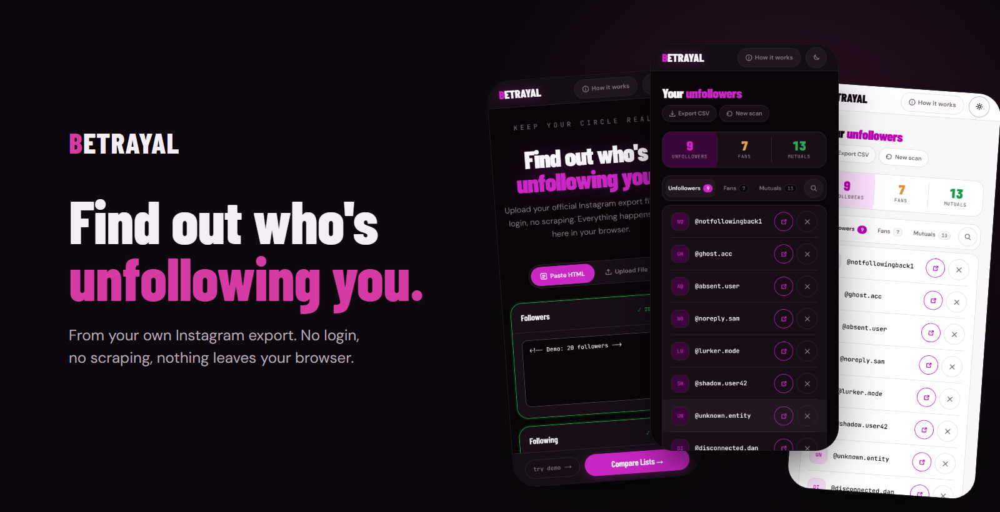
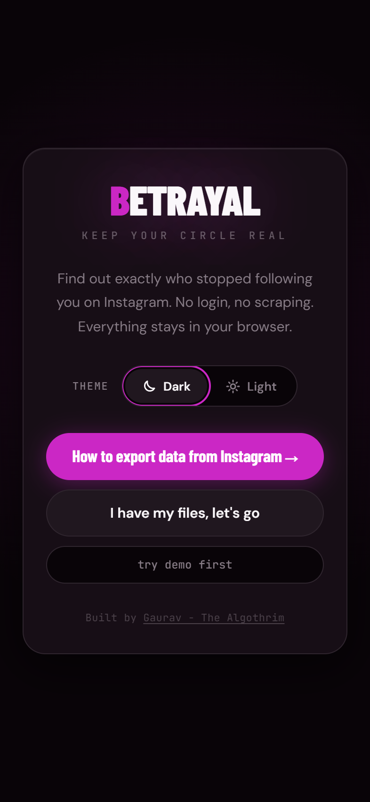
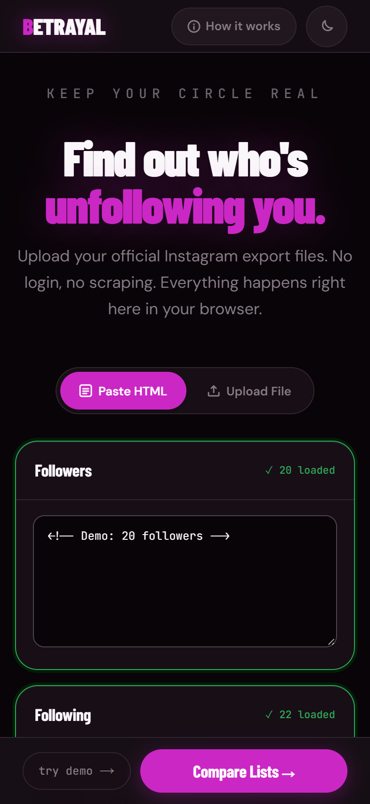
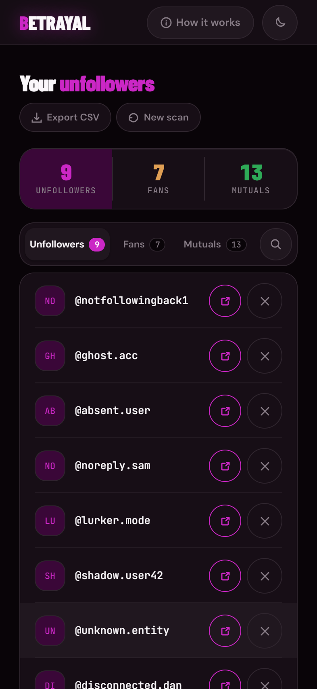
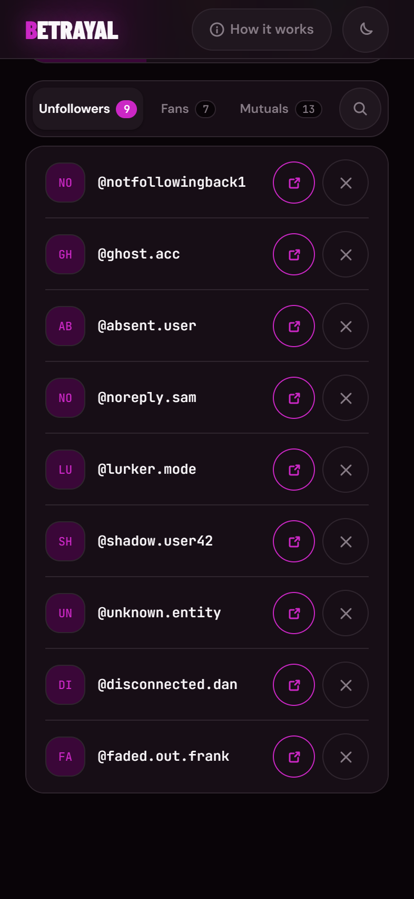
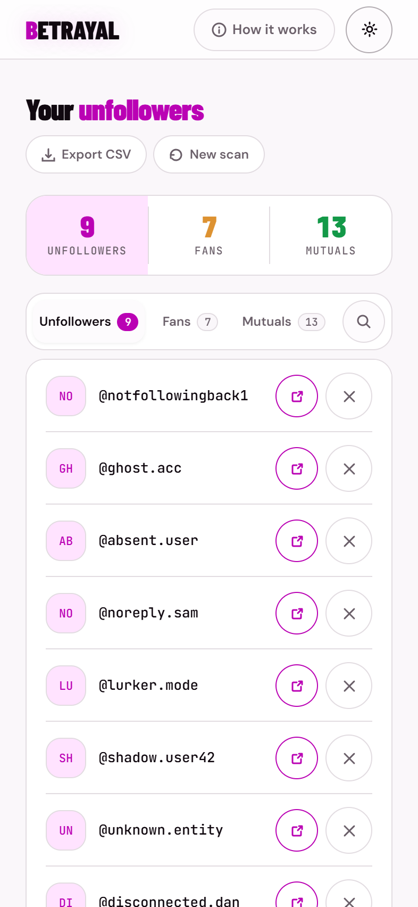
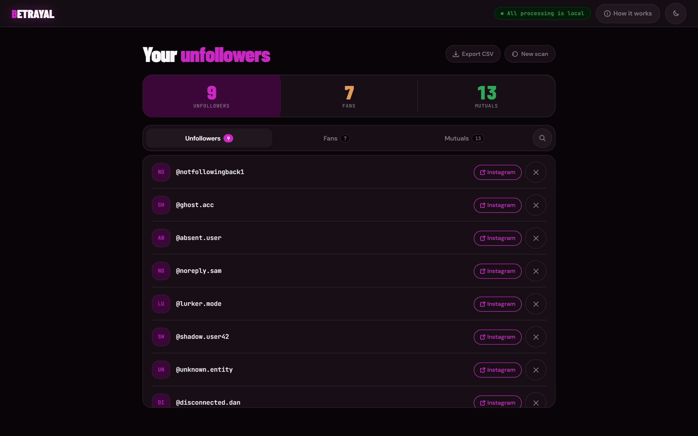
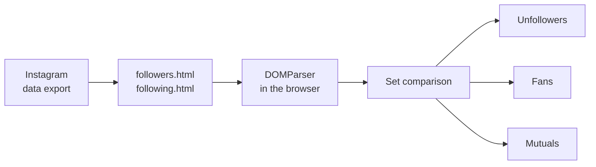

<p align="center">
  
</p>

<p align="center">
  <strong>See who doesn't follow you back on Instagram, from your own data export.</strong><br>
  No login, no scraping, no account risk. The comparison runs in your browser and nothing is uploaded.
</p>

<p align="center">
  <a href="https://betrayal-seven.vercel.app"><strong>Open Betrayal</strong></a>
  &nbsp;·&nbsp;
  <a href="#how-to-use-it">How to use it</a>
  &nbsp;·&nbsp;
  <a href="#how-it-works">How it works</a>
  &nbsp;·&nbsp;
  <a href="#run-it-locally">Run it locally</a>
</p>

<p align="center">
  
  
  
</p>

## Why Betrayal

Instagram does not tell you who quietly stopped following you. The tools that claim to ask for your password or a session token, and that is how accounts get locked or stolen.

Betrayal takes the safe route. Instagram already lets you download your own followers and following lists. Give Betrayal those two files and it compares them on your device: who you follow that does not follow back, who follows you that you do not follow, and who is mutual.

## Screenshots

<table>
  <tr>
    <td align="center"><br><sub>A two-minute start</sub></td>
    <td align="center"><br><sub>Paste or upload the export</sub></td>
    <td align="center"><br><sub>Unfollowers, fans, mutuals</sub></td>
    <td align="center"><br><sub>Open, or dismiss</sub></td>
    <td align="center"><br><sub>Light theme</sub></td>
  </tr>
</table>

<p align="center">
  
</p>

## How to use it

1. In Instagram, open **Accounts Center**, then **Your information and permissions**, then **Export your information**.
2. Export to your device, choose **Customise information**, keep only **Followers and following**, set the date range to **All time** and the format to **HTML**.
3. When Instagram emails the download, unzip it and find `followers_1.html` (older exports call it `followers.html`) and `following.html`.
4. Open Betrayal and paste or upload the two files, then **Compare Lists**.

The app has an illustrated 13-step guide for the export, and demo lists to try it without a file.

## Features

- **Three answers.** Unfollowers (you follow them, they do not follow back), fans (they follow you, you do not follow them) and mutuals.
- **Paste or upload.** Drop in the HTML files or paste their contents.
- **Dismiss the noise.** Hide celebrities and brands from the list; dismissals are remembered and can be undone.
- **Search and export.** Filter any list, open a profile in Instagram, or download a list as CSV.
- **Dark and light.** A dark theme by default and a light one, remembered per device.
- **Installable.** Add it to a phone's home screen like an app.

## How it works



- **Parsing** reads every profile link in the export with the browser's own `DOMParser`, keeps the handle, and ignores dates, headers and duplicates.
- **Comparing** is two sets and three filters, instant even for large accounts.
- **Storage** is only preferences: the theme, the input mode and the handles you dismissed, in `localStorage`. The lists themselves are never saved or sent anywhere.
- **Validation** catches the common mistakes, like a JSON export or the wrong file, with a plain message.

## Built with

| Layer | Choice |
|---|---|
| App | Next.js 14 App Router, React 18 |
| Styling | Hand-written CSS, Barlow Condensed, DM Sans and JetBrains Mono |
| Data | Nothing leaves the browser; preferences in `localStorage` |
| Hosting | Vercel |

## Run it locally

```bash
git clone https://github.com/TheAlgo7/betrayal.git
cd betrayal
npm install
npm run dev
```

Open http://localhost:3000 and choose **try demo first**.

| Command | What it does |
|---|---|
| `npm run build` | Production build |
| `npm run lint` | ESLint |
| `python scripts/readme-shots.py` | Rebuilds the screenshots in this README from the live app, using the demo lists |

## Licence

Copyright © 2026 Gaurav Kumar, [The Algothrim](https://thealgothrim.com). All rights reserved.

The code is public to read and learn from. It is not licensed for reuse. Betrayal is not affiliated with Instagram or Meta.
